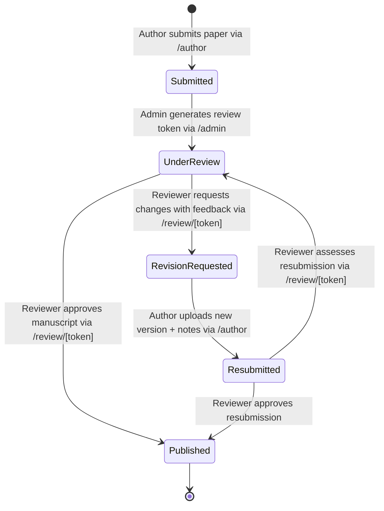

# IntelliSubmit - Project Context & Documentation

> **IntelliSubmit** is a modern, AI-augmented academic journal and manuscript submission, peer review, and editorial management platform. It streamlines the lifecycle of research papers—from author upload and metadata extraction to anonymous peer review and editorial publishing decisions.

---

## 1. System Architecture & Tech Stack

### Frontend & Application Framework
- **Framework**: [Next.js](https://nextjs.org/) `16.2.12` (Canary / Next.js 16 with App Router)
- **Runtime / UI Engine**: [React](https://react.dev/) `19.2.4` with `babel-plugin-react-compiler` enabled (`reactCompiler: true` in `next.config.mjs`)
- **Styling**: [Tailwind CSS v4](https://tailwindcss.com/) (`@tailwindcss/postcss`, `@custom-variant dark (&:where(.dark, .dark *))`)
- **Icons**: `@gravity-ui/icons`
- **Document Parsing**: `mammoth` (`^1.13.0`) for client-side `.docx` to HTML extraction
- **Path Aliasing**: `@/*` mapped to `./src/*` via `jsconfig.json`

### Authentication & User Management
- **Auth Engine**: [Better Auth](https://better-auth.com/) (`better-auth` `^1.6.25`)
- **Database Adapter**: `@better-auth/mongo-adapter` with official `mongodb` driver (`^7.5.0`)
- **Supported Auth Providers**:
  - Email & Password credentials
  - Google OAuth 2.0 (`GOOGLE_CLIENT_ID`, `GOOGLE_CLIENT_SECRET`)
- **Custom User Schema**: Extended with `role: { type: "string", defaultValue: "author" }`
- **Client SDK**: `better-auth/react` (`createAuthClient`, `useSession`, `signIn`, `signUp`, `signOut`)

### Backend & API Architecture
- **Auth Endpoint**: Next.js route handler at `/api/auth/[...all]` delegating to `better-auth` via `toNextJsHandler(auth)`
- **Core Business Logic & Paper Storage**: External/internal REST API server pointed to by `NEXT_PUBLIC_API_URL` (default: `http://localhost:5000`)
- **Database**: MongoDB (Atlas cluster or local database `intelli-submit`)

---

## 2. Directory Structure

```
h:/intelli-submit/
├── .env                          # Local environment secrets (DB URIs, Auth secrets, API URLs)
├── .env.example                  # Template for required environment variables
├── .gitignore                    # Git ignored directories (node_modules, .next, etc.)
├── AGENTS.md                     # Agent specific instructions (Next.js 16 breaking changes notice)
├── CLAUDE.md                     # Claude pointer referencing AGENTS.md
├── context.md                    # THIS FILE: Comprehensive project context and architecture reference
├── jsconfig.json                 # Path aliases configuration (@/* -> ./src/*)
├── next.config.mjs               # Next.js configuration (React compiler flag)
├── package.json                  # Dependencies, devDependencies, and npm scripts
├── postcss.config.mjs            # PostCSS configuration with @tailwindcss/postcss
├── README.md                     # Standard repository readme
├── public/                       # Static SVGs and assets
└── src/
    ├── app/
    │   ├── globals.css           # Tailwind v4 import, custom dark theme variables, grid pattern
    │   ├── layout.js             # Root layout: Geist fonts, dark mode inline script, Navbar
    │   ├── favicon.ico           # Application favicon
    │   ├── (auth)/               # Auth route group (unauthenticated layout)
    │   │   ├── login/
    │   │   │   └── page.jsx      # Login page (Email/password & Google OAuth, role-based redirect)
    │   │   └── register/
    │   │       └── page.jsx      # Registration page with Role selection (Author, Reviewer, Admin)
    │   ├── (main)/               # Authenticated / Portal route group
    │   │   ├── layout.js         # Pass-through main layout
    │   │   ├── page.js           # Marketing landing page with hero, dashboard mock, features
    │   │   ├── dashboard/
    │   │   │   └── page.jsx      # Route redirecting directly to /author
    │   │   ├── author/
    │   │   │   └── page.jsx      # Author Portal (Paper submission, upload validation, status tracking, resubmission modal)
    │   │   ├── reviewer/
    │   │   │   └── page.jsx      # Reviewer Portal (Token lookup, assigned paper list, workspace link)
    │   │   └── admin/
    │   │       └── page.jsx      # Admin Portal (Metrics, paper search/filtering, review token generator & share)
    │   ├── api/
    │   │   └── auth/
    │   │       └── [...all]/
    │   │           └── route.js  # Better-Auth catch-all API handler for Next.js App Router
    │   └── review/
    │       └── [token]/
    │           ├── page.jsx      # Dynamic review route with server metadata wrapper
    │           └── ReviewerWorkspace.jsx # Reviewer UI: split view, document preview, feedback form, publish/revision actions
    ├── components/
    │   ├── Navbar.jsx            # Sticky navigation, theme toggling (dark/light), session avatar, links
    │   └── DocumentPreviewer.jsx # Multi-format document viewer (.pdf iframe, .docx mammoth rendering, .doc fallback)
    └── lib/
        ├── auth.js               # Better Auth server configuration with MongoDB adapter and custom fields
        └── auth-client.js        # Better Auth React client instance and helper exports
```

---

## 3. Core Roles & Permissions

The application recognizes three distinct roles defined on the user account (`user.role`):

1. **Author (`author`)**:
   - Default role upon standard registration.
   - Access to **Author Portal** (`/author`).
   - Can submit manuscripts with metadata (Title, Abstract, Authors, Category, Keywords) and attached documents (`.pdf`, `.docx`, `.doc`).
   - Tracks submission lifecycle status (`Submitted`, `Under Review`, `Revision Requested`, `Resubmitted`, `Published`).
   - Views reviewer feedback and can resubmit revised manuscripts with author revision notes.

2. **Reviewer (`reviewer`)**:
   - Access to **Reviewer Portal** (`/reviewer`) and **Token-based Workspace** (`/review/[token]`).
   - Can access papers either via assigned list or by manually pasting a secure token or link.
   - Evaluates manuscript text and layout via the multi-pane `ReviewerWorkspace`.
   - Actions:
     - **Request Revision**: Submits detailed actionable feedback to the author; transitions paper status to `Revision Requested`.
     - **Approve & Publish**: Marks paper as `Published`.

3. **Admin / Editorial Board (`admin`)**:
   - Access to **Admin Portal** (`/admin`).
   - Editorial dashboard with real-time statistics:
     - Total Submissions
     - Pending Reviews (`Submitted`)
     - In Review (`Under Review`)
     - Revisions Needed (`Revision Requested`)
     - Resubmitted Papers (`Resubmitted`)
     - Published Papers (`Published`)
   - Search across papers by title, author name, or keyword.
   - Filter by status.
   - Generates unique peer-review tokens (`POST /api/papers/:id/generate-token`) and generates shareable reviewer links or pre-filled email invitations.

---

## 4. Manuscript Lifecycle & State Machine



### Status Descriptions
- `Submitted`: Fresh submission awaiting editorial review and reviewer assignment.
- `Under Review`: Review token generated; paper is assigned to peer reviewer(s).
- `Revision Requested`: Reviewer returned manuscript with constructive comments; author action required.
- `Resubmitted`: Author provided an updated draft and responses to reviewer critique; awaiting re-evaluation.
- `Published`: Final approval granted; manuscript marked ready for publication.

---

## 5. Key Components & Implementation Details

### `DocumentPreviewer.jsx`
- **Location**: `src/components/DocumentPreviewer.jsx`
- **Purpose**: Provides in-browser preview without requiring native desktop application viewers.
- **Features**:
  - **PDF Documents (`.pdf`)**: Rendered using embedded `<iframe>` pointing to the file URL or object URL.
  - **Word Documents (`.docx`)**: Fetches array buffer and uses `mammoth.convertToHtml()` to generate styled HTML preview client-side.
  - **Legacy Documents (`.doc`)**: Displays fallback notice with instant download link.
  - **Toolbar**: Header shows file type badge, file name, download button, view tab toggles (`preview` vs `info`), and full-screen toggle.

### `Navbar.jsx`
- **Location**: `src/components/Navbar.jsx`
- **Purpose**: Global responsive navigation bar.
- **Features**:
  - Theme toggler: Switches between light and dark modes with persistent `localStorage` synchronization and `dark` class toggling on `document.documentElement`.
  - Auth integration: Shows user profile avatar, role badge, and sign out button when logged in, or Login/Register buttons when unauthenticated.
  - Role-aware dashboard routing: `getDashboardHref()` directs user to `/admin`, `/reviewer`, or `/author` based on session role.
  - Mobile hamburger navigation drawer.

### `ReviewerWorkspace.jsx`
- **Location**: `src/app/review/[token]/ReviewerWorkspace.jsx`
- **Purpose**: Dedicated distraction-free peer review workstation.
- **Features**:
  - Dual-panel layout (adjustable views: Split View, Document Only, Feedback Only).
  - Left panel: Manuscript metadata (authors, categories, abstract, keywords, submission dates, revision history).
  - Middle panel: Integrated `DocumentPreviewer`.
  - Right panel: Comprehensive review form with decision toggles (`Approve for Publication` vs `Request Revisions`) and markdown/text feedback input.

---

## 6. External API Server Specifications (`NEXT_PUBLIC_API_URL`)

The application consumes an API server located at `process.env.NEXT_PUBLIC_API_URL || "http://localhost:5000"`.

### Expected API Endpoints

| Method | Endpoint | Description | Payload / Query |
| :--- | :--- | :--- | :--- |
| `GET` | `/api/papers` | Fetch papers with optional filters | `?status=<status>&search=<query>` |
| `GET` | `/api/papers/author` | Fetch all papers submitted by an author | `?email=<authorEmail>` |
| `POST` | `/api/papers` | Submit new manuscript | `multipart/form-data`: `title`, `abstract`, `authors`, `category`, `keywords`, `authorEmail`, `authorName`, `file` |
| `POST` | `/api/papers/:id/generate-token` | Generate secure review token for paper | None. Returns `{ success: true, paper, reviewUrl }` |
| `GET` | `/api/papers/review/:token` | Fetch paper metadata and file for reviewer | None. |
| `POST` | `/api/papers/review/:token` | Submit review decision and comments | JSON: `{ decision: "publish" \| "revision_requested", feedback, reviewerName }` |
| `POST` | `/api/papers/:id/resubmit` | Submit revised manuscript document | `multipart/form-data`: `file` (optional if text-only), `revisionNotes` |

---

## 7. Environment Variables Configuration

| Variable | Description | Example / Default |
| :--- | :--- | :--- |
| `MONGODB_URI` | MongoDB connection string for Better Auth adapter | `mongodb+srv://...` or `mongodb://localhost:27017/intelli-submit` |
| `BETTER_AUTH_SECRET` | 32+ character random secret used for session signing | `xK9mP2qL8rN5wJ3vY7tH1cB4dF6eG0aZ9s` |
| `BETTER_AUTH_URL` | Base canonical URL of the Next.js app | `http://localhost:3000` |
| `GOOGLE_CLIENT_ID` | Google OAuth Client ID for social login | `*.apps.googleusercontent.com` |
| `GOOGLE_CLIENT_SECRET` | Google OAuth Client Secret | `GOCSPX-...` |
| `NEXT_PUBLIC_API_URL` | Base URL for the IntelliSubmit backend service | `http://localhost:5000` |

---

## 8. Common Commands & Workflows

### Install Dependencies
```bash
npm install
```

### Run Development Server
```bash
npm run dev
# Starts Next.js app on http://localhost:3000
```

### Production Build & Linting
```bash
npm run lint
npm run build
npm run start
```

---

## 9. Next Steps & Development Roadmap

1. **AI Metadata Extraction**:
   - Integrate LLM pipeline (Gemini / OpenAI API) to automatically parse PDF uploads and pre-fill title, abstract, authors, and suggested keywords during step 1 of submission.
2. **Automated Notification Service**:
   - Send email notifications (via Resend, SendGrid, or Nodemailer) to authors when papers are accepted or revisions are requested.
   - Dispatch automated review invitations with tokens to peer reviewers.
3. **Plagiarism & Similarity Checking**:
   - Add integration hooks for automated manuscript similarity scoring prior to editorial review.
4. **Enhanced Document Annotation**:
   - Inline PDF commenting and highlight tools for peer reviewers directly inside the workspace.
